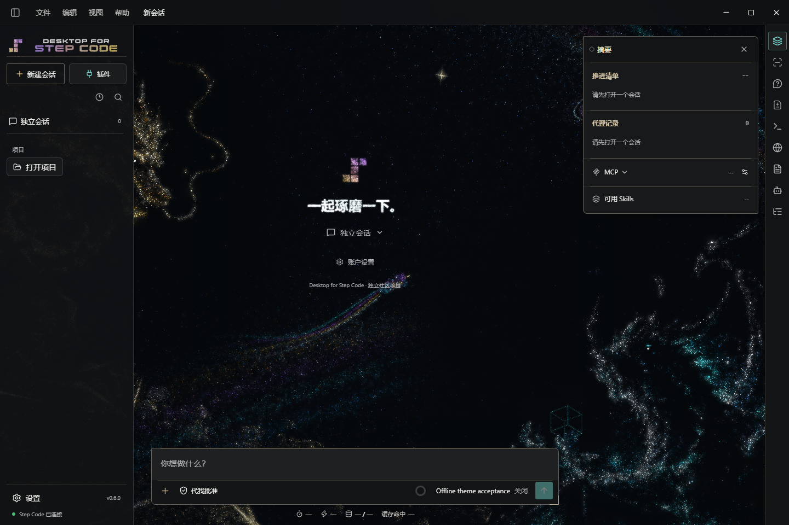
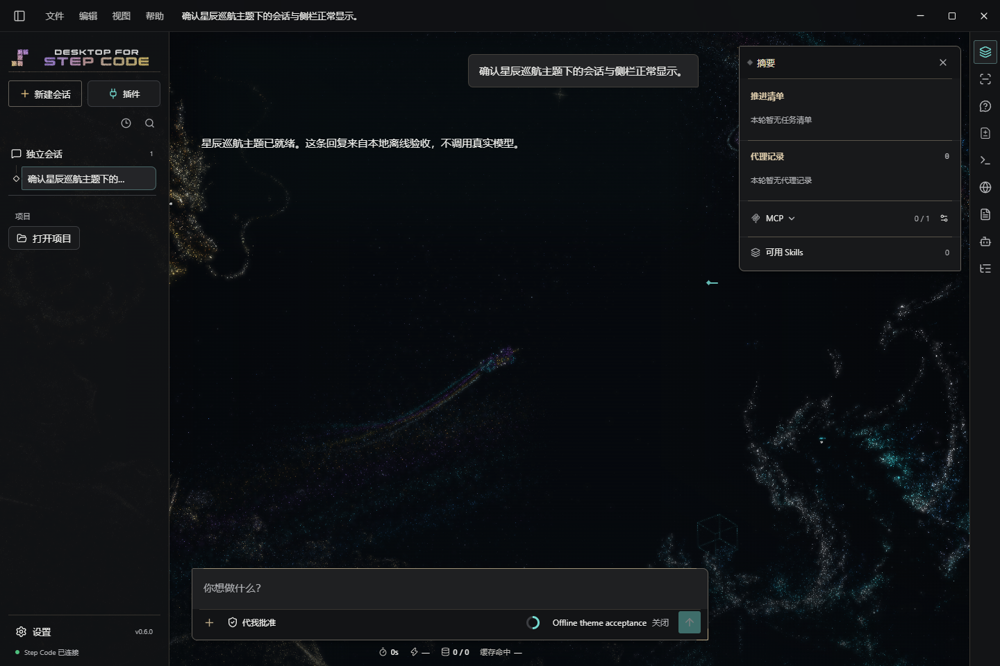

# 市场验证记录

## 第一方维护说明与职责边界（2026-11-13）

自定义背景 0.1.1 尚在投稿中，本次将来源推进到
`2c2ff1b7687dc2d57380df9e73e30f38d3aec585`。
相较下节已验来源 `769ccfb`，上游只修改插件 README 和开发规范；
背景声明、权限、执行资源、图标及宿主运行逻辑均未改变。
市场首页、投稿指南和安装说明明确第一方与第三方使用同一社区市场，
“由 DFSC 项目维护”不表示上游官方、免审或额外授权。
同时如实说明当前背景仍由宿主渲染，不把安装入口称为已完全外置的渲染模块。

上游重新通过 40 项定向测试、3 项文档检查及空白检查。
此次仅补维护说明，不重复原生安装或重打客户端；
下节原生证据仍对应市场快照 `c9cf109`，不作为新 README 逐字节安装验收。
市场资源与来源锁已按新提交重新生成，静态校验通过；
Python 35 项中 34 通过、1 项既有权限跳过，Node 32 项中 31 通过、1 项既有权限跳过。
元数据与主题检查零错误，仅保留 Stellar 既有提醒，其他插件登记和锁项不变。

## 自定义背景 0.1.1 声明更新（2026-11-13）

来源固定到 `7oMB2006/desktop-for-step-code@769ccfba9ae55014289f908003d9314fd18e1d2e`，
目录仍为 `theme-marketplace/plugins/custom-background`。同步工具通过 GitHub 取得并核对
七个原始文件的 Git blob，生成资源副本与来源锁；README 继续采用维护者审核说明。
新增作者 `Desktop for Step Code contributors`、DFSC 数值要求 `0.6.0`、
明确的 `external: []` 与随包 CHANGELOG。没有新增权限、外部组件、数据用途或费用。
相同版本号仍不能证明具备 #223 / `custom-background-v1`，也不替代主题的 `image-v1` 插槽。

| 验证 | 结果与边界 |
| --- | --- |
| 市场静态校验与来源锁 | 通过；仅更新背景插件，其他插件登记和完整锁项不变 |
| Python 单测 | 35 项：34 通过，1 项既有 Windows 符号链接权限跳过 |
| Node 单测 | 32 项：31 通过，1 项既有 Windows 符号链接权限跳过 |
| 展示声明检查 | 零错误；背景插件的三项缺失提醒消失，保留 Stellar 的三项既有提醒 |
| 主题检查 | 零错误，保留 Stellar v1 既有迁移提醒 |
| 上游定向测试 | 40 项通过，另有 TypeScript 检查与空白检查通过；未跑本地全套宿主验收 |
| 原生发现与 UI 安装 | 从已提交市场快照 `c9cf109` 经本地 Git 安装 0.1.1；发现和安装后均能读取正式作者、数值版本要求及空外部依赖，CHANGELOG 可由受限文档接口读取 |
| 背景生命周期 | PNG 导入、停启、正常重启持久化、卸载撤销、重装默认关闭及市场移除后基线恢复通过 |
| 隔离与退出 | 独立临时 profile，零页面异常、零模型请求；两次退出码均为 0、剩余窗口均为 0 |

原生检查使用 `integration/verify-custom-background.mjs` 和此前已交付的 Windows x64
0.6.0 体验包，宿主构建提交为 `ed7c6e46c5fdad85b678eff857ae0b39b96977ba`，
不是新打的客户端包，也不是以上声明更新提交的宿主构建。
证据保存在忽略目录 `test-results/custom-background-metadata-c9cf109/`；
选图对话框使用受控夹具，不修改日常 profile。随后只补充本文和维护者说明，
没有改变已验资源的声明、版本、CHANGELOG、图标、适配器或验证脚本。

本地 Git 通过不代表新版资源已在公共 main 上架或完成 HTTPS 安装、GitHub 认证；
也不包含 0.1.0 原地更新、真实账户、计费、macOS/Linux、安装器升级或长期性能验收。
宿主与市场 PR 的云端 CI、审核和合并分别判断，本次不自动合并或发布客户端。

## 自定义背景 0.1.0 收录候选（2026-11-12）

固定来源为 `7oMB2006/desktop-for-step-code` 的 #223 合并提交
`ed7c6e46c5fdad85b678eff857ae0b39b96977ba`，资源目录为
`theme-marketplace/plugins/custom-background`。通过 GitHub 固定提交同步六个原始
文件并核对 Git blob，再生成资源、来源锁和原生清单；维护者说明作为 README
覆盖，保留完整 MIT 通知及 Lucide ISC 图标许可。BVR、Hermes、Stellar 的
登记、完整锁项、资源和维护者说明均保持不变。

| 验证 | 结果与边界 |
| --- | --- |
| `python scripts/validate-marketplace.py --check` | 通过，四个插件的来源、锁与资源一致 |
| `python -m unittest discover -s tests -v` | 35 项：34 通过，1 项既有 Windows 符号链接权限跳过 |
| `npm test` | 32 项：31 通过，1 项既有符号链接权限跳过 |
| `node scripts/check-plugin-metadata.mjs` | 零错误；保留 Stellar 既有三项及背景插件三项缺失声明提醒 |
| `node scripts/check-theme-pack.mjs` | 零错误，保留 Stellar v1 既有提醒；此项不校验背景适配器语义 |
| 原始适配器声明回归 | 验证逐字节同步、来源锁、篡改后拒绝资源漂移及其他插件隔离，不冒充 provider 语义验证 |
| 原生市场发现与 UI 安装 | 通过；来源为 `dfsc-community`，安装记录及 `custom-background-v1` 由宿主确认，安装 README 字节与审核说明一致 |
| 图片导入、停启与重启 | 通过；真实宿主导入和解码 PNG，关闭时保留图片，再启用及正常重启后参数与图片一致 |
| 卸载、重装与市场移除 | 通过；卸载停止生效，重装保留图片但默认关闭，移除市场后原有插件基线不变 |
| 隔离与退出 | 两次启动均为实际打包 EXE、独立用户目录和 `app.asar` 主模块；renderer 沙箱保持开启，零页面异常、零模型请求，两次退出码均为 0、剩余窗口均为 0 |

原生检查使用 `integration/verify-custom-background.mjs`，实际克隆已提交的市场
快照 `1985f62aae9a38ad646a902a6080695cd2d19bbe`，通过 `file://` 原生 Git
来源及插件中心安装，而非直接写入插件目录。证据保存在忽略目录
`test-results/custom-background-market-1985f62/`，不上传临时 profile 或日志。
后续仅补本文及 README 的运行说明，不改变该快照的插件资源、登记、锁或验收脚本。

宿主为 Windows x64 的本地 0.6.0 体验包，构建收据固定到上述宿主合并提交，
源码树与已验收 head `02750b5131780c731bb04cc8c86681e3d75fb9cd` 一致；
不能仅凭相同版本号推断其他安装包支持。验收使用独立数据目录、回环提供商，
不修改现用账号或应用。系统选图对话框由受控夹具返回测试 PNG 路径，
不是实际操作系统对话框交互验收。宿主此前的分区材质、主题插槽矩阵、
MiniChat 和退出验收不计为本次市场脚本重新覆盖。

背景来源的 `dfsc.plugin.json` 缺少 `authors`、`requirements.dfsc`、
`requirements.external`，本次如实保留三项提醒，不代作者补写或编造版本范围。
本地 Git 成功不等于 GitHub 网络安装、认证或公共 main 已上架；本记录也不代表
新 PR 云端 CI、真实账户/计费、macOS/Linux、安装器升级或长期性能已通过。
市场候选仍须独立审核及合并，不自动发布客户端。

## Hermes x DFSC 合并后来源同步（2026-11-11）

Hermes companion PR #1 已合并，来源由
`0db4aa9655e03124e166f3d3fc98346d66cd0d1f` 更新到实际 main 合并提交
`df523a05e45355d43b911cdb78c163a7a120b1dd`。DFSC 宿主 PR #225
也已合并，宿主合并提交为 `cb8852cef7afe38fe342fcdf55dd26c59dee0ba8`。
资源仍为 0.3.0，companion 仍为 0.2.0；市场只同步资源，不分发 companion、
宿主安装器或任何真实 profile。两项目合入不等于公开安装包已具备新接口。

同步前核对 canonical 市场仓库及 GitHub 身份均为 `7oMB2006`。
通过已认证 GitHub API 适配器调用原生 `marketplace.sync`，仅同步
`hermes-engineering-bridge`。13 个来源文件均核对原始 Git blob，
再由工具生成资源副本、README 审核覆盖、原生清单和来源锁，没有手改生成哈希。
来源新增的 `desktop.connection.guides` 按实际宿主契约校验：仅允许
`setup`、`firstTask`、`troubleshooting` 引用已声明的同包页面 ID，
不开放任意协议、方法、身份路径或执行入口。

| 验证 | 结果与边界 |
| --- | --- |
| 固定 SHA 网络同步与市场静态校验 | 通过；来源提交、Git blob、SHA-256、13 项资源清单和审核 README 一致 |
| 市场 Python 单测 | 34 项：33 通过，1 项既有 Windows 符号链接权限跳过 |
| 指南声明回归 | 接受缺省、空对象及有效页面引用；拒绝未知字段、缺失页面、文档路径、URL 和不合法类型，失败不改变已安装副本 |
| 其他插件边界 | BVR 与 Stellar 的来源条目、完整来源锁、资源和维护者说明均保持不变 |
| 已确认 Hermes 图标 | 原始头像和两份 17px 明暗图标的来源锁均保持不变 |
| 空白检查 | `git diff --check` 通过 |

随后整合市场主线 `130c691f925fccbc55ae929316746fa9200e7716` 时，完整保留主线
已合入的展示声明投稿校验、BVR 更新及主题作者交付内容。上表“其他插件边界”
仅指此前 Hermes 单独同步步骤，不表示撤回这些主线更新，也不代表重新验收了其他插件。
整合后的静态校验与完整测试重跑通过：Python 34 项中 33 通过、1 项既有跳过，
Node 32 项中 31 通过、1 项既有跳过。元数据扫描零错误、3 项既有 Stellar
声明缺失警告；主题扫描零错误、1 项既有 v1 迁移警告。没有为了门禁清除这些提示。

上表仅记录市场静态与受控单测，Windows 候选包结果见下节。
真实 Hermes/模型请求、聊天渠道、计费、macOS 和市场 PR 云端 CI
仍须独立判断，不由静态结果推断通过。没有自动合并市场或创建发行版。

### 合并后 Windows 候选包

独立冻结 DFSC `cb8852cef7afe38fe342fcdf55dd26c59dee0ba8` 的干净源码，
在私有构建目录重新构建并暂存固定运行时，没有写共享 runtime junction。
源码树与 #225 最终验收 head 一致，Step pin 保持
`29eb460780489801ce8afc8bffc1a2efae7cbded`，Node 为 24.16.0，
53 项补丁源码哈希与清单一致，没有升级依赖或运行时基线。

| 包内验证 | 结果与边界 |
| --- | --- |
| 文件完整性与更新元数据 | 通过；1,444 项冻结源码、109 项 asar 构建文件、1,396 项运行时文件、27 项终端文件、10 项额外资源与构建输入一致 |
| 全新 profile 安装市场资源 | 7 组通过；来自本 PR 实际清单与资源的隔离本地市场，经插件中心安装，零模型请求 |
| 已提交 Git 市场安装 | 通过；本地提交 `082db8c` 经 `file://` 原生克隆、UI 安装、刷新、卸载重装、原生技能及命令发现；元数据与图标原始字节一致，零模型请求，退出码 0、剩余窗口 0 |
| 通用外部接口 | 9 组通过；真实 Python companion 与回环模型，包含 Ask 新会话、幂等、本机允许及拒绝审批、停止、重启回执、撤销 |
| 插件展示入口 | 17 组通过；主视图、侧栏、独立窗口、真实 Hermes 资源、更新卸载及 IPC 隔离 |
| MiniChat | 通过；包含真实 PTY、审批、大小窗交接、草稿及阅读位置保留、主题资源读取 |
| Remote | 通过；包内 SDK/helper、范围路由、队列、审批、Plan、图片及窄窗口；退出重启注入仍仅源码模式覆盖 |
| 插件宿主授权 | 通过；原生 SDK、允许及拒绝、取消、授权复用、账户更换撤销，全部为回环提供商 |
| 常规 Electron | 通过；真实 RPC、设置、MCP、主题、窄窗口、渲染器隔离和新旧 profile 首屏 |

安装器 SHA-256 为
`ef2abbd273c635255fa7eeb4950c8b8556e77215048758b69b4a0c0b1566dec7`。
本机候选与收据在 `D:\DFSC Builds\hermes-main-20261111-cb8852c`，
原生证据在 `D:\DFSC-Preview-QA\hermes-postmerge-20261111`。
通用接口验收使用独立脚本副本补充包路径，记录原脚本 SHA 和局部 diff，
断言实际 exe、`app.isPackaged` 及独立 `userData`，未把源码启动计为包内通过。

上述流程全部使用一次性 profile 和回环模型，不读取或修改现用账号配置。
实际 Hermes 网关/真实模型、物理麦克风、公开市场 main、干净机器、macOS
和安装器升级尚未在本轮验证；包内完整录音转写也未由按钮检查替代。
这是本地 Windows 交付候选，不是公开发行，也不自动合并本市场 PR。

Git 场景使用 `integration/verify-dfsc.mjs`，已对齐当前插件中心，
核对实际包路径及独立用户目录。发现态仅比较宿主公开的描述和依赖，
安装态比较完整入口声明与宿主校验后的图标数据，不将相同版本号当作同一资源。
默认输出为新时间戳目录，也可显式设置 `DFSC_VERIFY_OUTPUT`；
该场景通过不等于公开远端 main 已更新。

## 主题作者资源合并后复核（2026-11-11）

宿主 PR #232 已以 `310c67987cfd8ba747ee3290348e4b7a54cc02ae` 合入 main，
市场 PR #10 已以 `61b9861d089e700e89aad74baea3b0d4f2e0f41a` 合入 main。
主题投稿指南移除“等待宿主合入、市场 PR 保持草稿”的过时指引，
继续提供主线入口，并将固定预览改为宿主实际合并提交的源码基线。
下方候选阶段记录按历史保留，不再代表当前交付状态。

- 通过 GitHub Contents API 实际读取宿主 main 上的指南、组合协议、Schema
  和起步包，共 13 个文件；其中起步包 10 个文件完整存在。
  解码后的字节与合并提交逐一相等，Git blob SHA 也匹配。
- 固定合并提交的中文指南和起步包目录入口均可读取，与 main 内容一致。
- Markdown AST 检查两仓库 12 份作者文档的 44 个本地相对链接，全部存在；
  不是所有外链、标题锚点、浏览器排版或原生安装验收。
- 市场资源和来源锁检查通过。Python 27 项：26 通过、1 项 Windows
  文件符号链接权限跳过；Node 32 项：31 通过、1 项同类权限跳过。
- 展示声明保留既有 4 条 warning，旧 v1 主题保留 1 条迁移 warning，
  均无 error；宿主独立 v2 起步包专项检查零 error、零 warning。

复核报告位于忽略目录
`test-results/theme-authoring-published-links-20261111/report.json`。
本轮只更正两份文档，不修改插件资源、registry、来源锁、解析器来源或 CI，
不运行资源同步，也未打包或发布客户端。源码交付不等于所有旧客户端已兼容；
个人图片编辑器仍属于独立的宿主 #223 草稿候选。
本条不代替新文档 PR 的云端检查、原生解码、真实账户或平台兼容性验收。

## 作者路径独立交付复验（2026-11-11）

市场候选仍基于 `b33226f759e5db6564bf2206b926cbbfe070edcd`，
不修改已收录插件、来源锁或原生目录。宿主作者指南与示例已拆到以主线
`a72e550f3954ea6d957b7f8506f8ef8106b3fa08` 为基线的独立候选，
不再与 #223 未提交的背景材质或退出修复混在一起。
两侧指南明确个人图片编辑器是独立宿主候选，声明插槽不等于已有上传入口。

- Python 27 项：26 通过、1 项 Windows 文件符号链接权限跳过。
- Node 30 项：29 通过、1 项同类权限跳过；目录 junction 回归通过。
- 资源与来源锁检查通过；展示声明保留既有 4 条 warning，主题检查保留
  v1 关闭插槽/迁移的 1 条 warning，均无 error；新示例零 error/warning。
- 宿主干净主线专项测试 34 项：33 通过、1 项权限跳过，类型检查通过。
- 两仓库 12 个作者路径 Markdown 的 44 个本地相对链接检查通过，
  不等于远程链接、排版或完整标题锚点验收。
- 解析器来源改为已合入主线的上述完整 SHA；确认内容与原副本完全相同，
  LF 哈希不变，不执行插件代码，也不在 CI 动态下载解析器。

前一轮 Windows 图片替换原生验收仍只归属于当时的隔离体验包；
不把旧体验包当作本次干净主线的重构建证据。
市场交付保持依赖宿主指南/示例先合入；在此之前不合并依赖 main 链接的市场 PR。
宿主候选已创建为 PR #232，提交为
`26cbdaa0f2b9b6dc93f60a68841a74b231edfef2`；
指南提供固定提交的预览链接，不用尚未合入的 main 链接冒充已交付文件。
本条只记录本地复验，不声称新 PR 云 CI、其他平台、上架或发布已完成。

## 主题作者路径与专项静态检查（2026-11-10，本地候选）

基于市场 `b33226f759e5db6564bf2206b926cbbfe070edcd`，补充中文主题投稿指南、
README/CONTRIBUTING 入口、主题 PR 清单，以及读取实际同步副本的 Node 静态检查。
未修改 registry、lock、原生目录或任何已收录插件资源，也未运行上架同步。

- `python scripts/validate-marketplace.py --check` 通过，三个现有插件与来源锁保持一致。
- Python 27 项：26 通过，1 项 Windows 文件符号链接权限跳过。
- `npm ci --ignore-scripts` 与 `npm test` 通过；Node 30 项：29 通过，
  1 项 Windows 文件符号链接权限跳过，目录 junction 边界回归通过。
- 展示声明检查无 error，保留现有四条缺失声明 warning；主题专项检查无 error，
  旧星辰 v1 给关闭插槽与迁移提醒，不强迫其升级或开放替换。
- 新 v2 示例包单独检查无 error/warning。支持错误声明、漏图、8 MiB 超限、
  对比度、未知渲染器和插槽类型的负向检查，合法关闭插槽的主题仍通过。
- 组合解析器直接复用宿主固定提交 `33bd0dd46df796e5455a615983f27a8bcfa6ca5f`
  的原始实现，带 MIT 许可、来源和 LF 内容哈希回归；不动态获取或执行插件代码。

配套宿主改动提供独立 v2 示例与中文快速入门。宿主 35 项专项回归中
34 通过、1 项 Windows 文件符号链接权限跳过，类型检查通过。
Windows 隔离原生验收复用已有 `custom-background-exitfix-20261110-preview`，
没有重新构建客户端：发现/安装不自动启用、原生 PNG 解码、外观选择、
非空像素、个人图片替换、单背景与 UI 保留、跟随主题、760px、
重启首帧和卸载回退通过，三张截图已检查。
本地证据保存在宿主 `output/playwright/theme-authoring-20261110/`，
其中 JSON 的 source 简写指新示例来源，不是对旧体验包全部未提交代码的来源证明；
旧包完整来源仍以其既有 `source-receipt.json` 为准。

这些是本地候选结果，不是新包、当前云 CI、macOS/Linux、模型、完整场景几何
或真实第三方作者独立接入验收。宿主指南/示例的跨仓库链接须待配套宿主改动
先交付后再对外承诺可用；两仓库均尚未提交、推送或发布。
## 星辰巡航主题 0.1.0（2026-11-07）

DFSC 主题宿主 PR #210 已合并。市场固定到实际合并提交
`d7b19917a315c00c41cd8a22e2dcfe6d6d5b862e` 的
`theme-marketplace/plugins/stellar-cruise`，没有使用浮动分支或未合并源码。
同步工具通过 GitHub 读取六个原始文件并核对 Git blob，生成安装副本、
来源锁和原生清单；维护者中文 README 作为审核覆盖，不改变原始主题资产。
Hermes 与 BVR 的来源、资源和锁定记录保持不变。

| 验证 | 结果与边界 |
| --- | --- |
| 固定 SHA 网络同步与市场静态校验 | 通过；Git blob、SHA-256、资源大小与审核 README 一致 |
| 市场 Python 单测 | 27 项：26 通过，1 项 Windows 符号链接权限跳过 |
| 原生市场发现与界面安装 | 通过；条目来自 `dfsc-community`，安装后逐文件哈希匹配市场副本 |
| 安装后的中文使用说明 | 通过；实际插件详情页读取市场审核 README 并显示兼容性要求 |
| 安装生效边界 | 安装不自动启用；需在外观中手动选择，无模型请求 |
| 动态星海 | 通过；实际帧变化、解码后的非空彩色像素及封面、双龙数据读取 |
| 外观与重启 | 通过；动态开关、65% 亮度与重启首帧恢复 |
| 内置主题往返 | 通过；切换后释放场景，再次选择后重新加载 |
| 会话与侧栏 | 通过；真实打包 runtime 经过回环提供商完成一次离线回复 |
| 窄窗口 | 通过；无文档横向溢出，保留真实截图 |
| 卸载与重装 | 通过；卸载当前主题回退「原版深色」，场景释放，原有插件基线不变 |

验收使用 Windows x64 的 DFSC 预览包，宿主源码提交为
`25fbbd58df9a240424304735d1e3495af24dfefb`，包含后来经 #210 合入的主题实现；
Step runtime pin 为 `29eb460780489801ce8afc8bffc1a2efae7cbded`。
这不是声称公开的所有 `0.6.0` 安装包都兼容。

原生验收使用本市场生成的实际资源副本，只复制清单和插件目录到临时本地市场，
不复制 `.git`、测试档案或个人配置。应用使用一次性用户目录，先初始化内置
StepPage 再记录插件基线，防止把首次准备的内置资源误判为主题残留。
安装、发现和主题启用不发模型请求；会话验证只访问受控回环提供商，
未调用真实模型、账号、媒体或付费服务。renderer 未出现页面异常。
旧客户端不会因市场更新自动获得主题宿主；本轮未测试 macOS/Linux 主题体验、
长期性能、安装升级或 GitHub 网络来源安装。

可重复执行：

```powershell
$env:DFSC_DESKTOP_ROOT = '<包含主题宿主的 Desktop 源码目录>'
$env:DFSC_VERIFY_EXE = '<已打包 Desktop for Step Code 可执行文件>'
$env:DFSC_VERIFY_REVISION = '<该打包程序的源码提交>'
node integration/verify-stellar.mjs
```

证据写入忽略目录 `test-results/stellar/`。用于投稿的图均来自隔离应用的真实截图，
不是设计稿。欢迎页与会话各保留一张；主题封面本身继续使用来源资产。





本次素材按作者确认的 DFSC 主题投稿范围分发；未把美术、品牌或第三方权利
重新许可为 MIT，具体边界见主题收录说明。静态校验与本地原生验收不代表
投稿 PR 云端 CI 已通过，也不代表主题已经进入默认市场。

## BVR 图标资源 0.1.1（2026-11-07）

BVR 来源 PR #27 已合并，本次从 `fd2ab83b46b8793d80f8f8c6008945babdcbba80`
更新至实际合并保留提交 `db78c19f9ac27070540e5ff31addff4a31cf63a4`。
使用同步工具通过 GitHub 读取固定提交及原始 Git blob，重新生成 BVR 资源和来源锁。
资源版本升至 `0.1.1`，更换维护者提供的图标并去除外侧白边；运行逻辑、MCP、
技能、命令及配置协议均未改变。Hermes 资源、说明和来源锁记录保持不变。

| 验证 | 结果与边界 |
| --- | --- |
| BVR 合并提交云端 CI | 通过；Windows、Ubuntu 均成功 |
| 固定 SHA 网络同步与市场静态校验 | 通过；Git blob、SHA-256、版本及审核说明覆盖一致 |
| 市场 Python 单测 | 27 项：26 通过，1 项 Windows 符号链接权限跳过 |
| 实际市场副本原生发现、安装和文档读取 | 通过；来源为 `dfsc-community`，分类和中英文作者说明保留 |
| 新图标与资源版本 | 源文件、市场副本和安装副本均为 `0.1.1`，图标 SHA-256 完全一致 |
| 技能、`/bvr` 与真实 BVR MCP | 通过实际资源加载、MCP 初始化和三项工具声明，未发出 `tools/call` |
| 卸载、重装及私密配置保留 | 通过；显式独立 Plan 配置不变 |

图标为 512 x 512 PNG、66,300 字节，SHA-256 为
`fe8f6a4dd63c0727eb2bdbd4d02821d59ffb6675105e6c28738eb3ea82ecf76b`。
与来源一起分发原有许可证；不因维护者提供插画就宣称原创或授权已经核实。

验收使用 Windows x64 预览构建的 Step runtime
`81e79bc4b699148d6823fedde9b5e70d9a80255f`，配合 DFSC
`057961c5ae8e561ee4d4e882cc79ee8d0d99dcea` 的宿主模块。
通过 `--marketplace` 显式选择本市场的真实生成目录，使用一次性隔离 profile。
本轮未重新构建或启动图形应用，不改动日常应用、快捷方式或用户配置。
这些结果不代表真实模型、媒体、ASR、计费或 macOS/Linux 验收；
市场 PR 云端检查另行判定。市场合并和刷新也不会自动替换既有安装副本。

## BVR 合并后来源固定（2026-11-07）

BVR 来源 PR #26 已合并。本次将投稿 #2 从已验收的分支提交
`3733f49d90a133774654092681440f03666581e8` 更新为主分支实际保留的
`fd2ab83b46b8793d80f8f8c6008945babdcbba80`，并重新通过 GitHub 同步资源。
分类规范 PR #3 也已合并，来源审核与分类依赖均已解除。

核对两个来源提交之间的插件、运行代码、测试、验证脚本及依赖清单，无内容差异。
新的市场副本逐文件匹配合并提交的 Git blob，来源资源的文件哈希清单保持不变，
仅更新来源提交及市场审核的技术说明；Hermes 资源与来源锁记录保持不变。

| 验证 | 结果与边界 |
| --- | --- |
| BVR 合并提交类型检查与单测 | 通过；43 项测试全部通过 |
| BVR 合并提交云端 CI | Windows、Ubuntu 均通过，仅代表 BVR 仓库测试 |
| 固定 SHA 同步与市场校验 | 通过；来源、资源、README 审核覆盖和锁定清单一致 |
| 市场 Python 单测 | 27 项：26 通过，1 项 Windows 符号链接权限跳过 |
| 实际市场副本原生发现、安装、文档读取 | 通过；分类、关键词、中英文说明、教程与链接保留 |
| 图标、技能、`/bvr` 与市场来源记录 | 通过；安装来源为记录确认的 `dfsc-community` |
| 真实 BVR MCP 初始化与三项工具声明 | 通过；没有发出研究或模型请求 |
| 原生卸载、重装与私密配置保留 | 通过；独立 Plan 配置保留 |

使用同一已交付 Windows 预览包的 Step runtime，配合 DFSC
`12c13170f8f80945cfa245c1297b81d527f3ff23` 的宿主模块。
本轮再次比对 runtime pin 和完整 Windows patched-source hashes。
宿主模块通过 `--host-modules` 显式选择，验收数据均在一次性隔离 profile 内。
此前交付的 Windows 预览包已做图形配置验收；本轮未重新构建或启动图形应用。

本次完成的是合并后来源固定及资源复验，不是宿主发版、真实媒体/ASR/计费或
macOS 验收。不改动日常应用、快捷方式、账户或配置，不制作新安装包。
市场收录面向具备 BVR 宿主能力的构建，不代表所有公开 `0.6.0` 安装包均兼容；
新宿主的公开分发仍需单独处理。

## BVR 分类与作者说明（2026-11-06）

BVR 投稿 #2 更新固定来源为
`7oMB2006/Bilibili-Video-Research@3733f49d90a133774654092681440f03666581e8`，
来源 PR 仍为 #26。投稿分支包含分类校验 PR #3；不代替该 PR 的独立审核。
通过 GitHub 同步原始 Git blob，并检查作者 `dfsc.plugin.json` 与来源逐字节一致。
分类为 `research`、`audio-video`，关键词为「视频研究」「字幕」「语音转写」。
未在 registry 或原生清单重复声明分类，既有 Hermes 资源与锁记录保持不变。

| 验证 | 结果与边界 |
| --- | --- |
| 市场静态校验 | 通过；两项资源、来源 SHA、Git blob 与 SHA-256 一致 |
| Python 单测 | 27 项：26 通过，1 项 Windows 符号链接权限跳过 |
| BVR 类型检查与单测 | 通过；43 项测试全部通过 |
| BVR 来源 PR 新提交云端 CI | Ubuntu 和 Windows 均通过 |
| 实际同步市场副本的原生发现、安装 | 通过；安装来源为记录确认的 `dfsc-community` |
| 分类、关键词、中英文简介与包内文档 | 发现态、安装态和重装态均通过宿主实际展示解析器 |
| 社区教程、作者链接卡片、技术说明导航 | 通过；包内相对链接可读取本市场审核的 README |
| PNG 图标、技能与 `/bvr` 加载 | 通过；使用实际资源加载器 |
| 真实 BVR MCP 初始化及三项工具声明 | 通过；无 `tools/call` 或模型请求 |
| 卸载、重装、私密配置保留 | 通过；显式 Plan 独立配置不变 |

宿主模块来自已合并 #204 的 DFSC main
`12c13170f8f80945cfa245c1297b81d527f3ff23`。原生 bundle 使用已打包 Windows
runtime，其 pin `81e79bc4b699148d6823fedde9b5e70d9a80255f` 和完整 Windows
patched-source hashes 已与该 main 的 manifest 比对一致。
验收脚本使用显式 `--host-modules` 选择当前宿主源码模块；没有改写已有运行时，
也没有把源码模块验收描述为重新构建了图形应用。

验收使用一次性隔离 profile，并显式选择本市场真实生成目录，不是另造来源副本。
没有修改日常应用、快捷方式、凭据或用户配置，没有重启应用或制作安装包。
这不等于真实账户、媒体、ASR、计费、图形界面或 macOS/Linux 验收。
市场投稿仍需来源审核保留、分类校验依赖审核，以及兼容宿主交付；
公开默认市场暂不可据此宣称已经能安装 BVR。

## BVR 收录候选（2026-11-04）

新增 `bilibili-video-research` 0.1.0 候选资源，固定来源
`7oMB2006/Bilibili-Video-Research@047cb9adc4f0227c29ece23449d5e651c3ad16ec`，
路径 `plugins/bilibili-video-research`。来源 PR 为 BVR #26，当前市场仍为收录草稿。
资源由同步工具通过 GitHub 固定提交取得并校验 Git blob，不使用本地文件伪造来源锁。
既有 Hermes 来源、资源和锁定记录未改动。

| 验证 | 结果与边界 |
| --- | --- |
| 市场静态校验 | 通过；两个资源条目与各自锁定内容一致 |
| Python 单测 | 21 项：20 通过，1 项宿主不允许符号链接而跳过 |
| BVR 类型检查与单测 | 类型检查通过，42 项测试通过 |
| BVR 来源 PR 云端 CI | Ubuntu 和 Windows 通过；Windows fixture 使用规范化临时目录，兼容 8.3 短路径 |
| 实际市场副本的原生发现、安装 | 通过；使用 DFSC 原生管理器，不是仅解析 JSON |
| PNG 图标、实际技能与 `/bvr` 加载 | 通过 |
| 真实 BVR MCP 初始化及三项工具声明 | 通过；没有发出 `tools/call` 或模型请求 |
| 卸载重装及私密配置保留 | 通过；显式 Plan 独立配置不变 |

本次运行使用 Windows x64 本地 DFSC 0.6.0 预览的实际
`resources/runtime`：Step pin `81e79bc4b699148d6823fedde9b5e70d9a80255f`
及其声明的 overlays，包含尚未发布的插件中心/BVR 宿主集成。
没有修改日常用户数据目录。验收通过 BVR 的
`scripts/verify-dfsc-plugin.mjs`，显式传入本市场目录与市场名
`dfsc-community`；没有另建一个 BVR 资源副本冒充市场条目。
本地 JSON 证据留在验收输出目录，不随插件上传。

这不等于真实账户、外部视频、媒体质量、ASR 可用性、计费或 macOS/Linux
验收。市场 PR 自身的云端检查与上述本地结果分别判断。
新的图形配置和跟随账户仍依赖另行审核、交付的 DFSC 宿主；
即使静态 CI 绿色，也不自动满足市场合入或公开可用条件。

## 早期私有联调（2026-10-28）

日期：2026-10-28。社区市场：`dfsc-community`，仓库：
`7oMB2006/dfsc-community-plugins`。当前实际收录一个资源插件
`hermes-engineering-bridge`，固定来源与逐文件校验值见根目录的 registry 和 lock。

## 普通 DFSC 0.6 原生检查

使用发布版提交 `195f10f906bd2d42ed8e1a86f91614f0cef8cbe2` 对应的普通 DFSC
macOS ARM64 实际应用，配合 `integration/verify-dfsc.mjs` 和一次性用户数据目录：

| 检查 | 本地目录来源 | 本地 Git 来源（file://） |
| --- | --- | --- |
| 原生市场读取清单并发现条目 | 通过 | 通过 |
| 界面安装、版本与图标 | 通过 | 通过 |
| 实际 Step Code 加载技能与帮助命令 | 通过 | 通过 |
| 卸载、重装及原有内置插件保留 | 通过 | 通过 |
| Git 更新市场 | 不适用于目录快照 | 通过 |

Git 检查使用本地 Git 传输，覆盖原生 clone、pull 和安装路径。它不等于已经验证
GitHub 私仓的网络访问和 Git 认证。当前机器的 GitHub 连接器访问权限也不自动成为
DFSC 调用 Git 时的读取凭据。

测试不调用模型、不发送飞书、不派工程，不修改真实账户、工程任务或原有应用配置。
本机证据在忽略目录 `test-results/`，包含 JSON、日志和安装界面截图，不作为用户
运行数据上传到仓库。

## 校验和维护工具

校验覆盖市场、登记、锁文件与资源副本的一致性；同步按完整提交读取并校验 Git
blob，离线模式核对已有锁定字节。回归另覆盖多插件、错误哈希、路径边界及失败
更新保留原版本。CI 在 Ubuntu 和 Windows 运行静态校验与 Python 单测，原生应用
检查需具备实际 DFSC 开发环境后单独执行。

## 已确认的上游边界

- 本地来源文件夹名需使用 `dfsc-community-plugins` 这样的安全名称，不能含空格。
- 首个原生运行时会准备 StepPage 等内置资源；验收先建立该基线，再比较社区插件
  安装和卸载是否保留原有资源。
- 当前更新市场不替换已安装副本；资源升级沿用卸载、重装和会话重载。
- 市场资源不安装 Hermes companion 或宿主能力。Windows 实机、私仓网络认证、
  真实飞书闭环和过夜工程没有由上述 Mac 测试证明。
